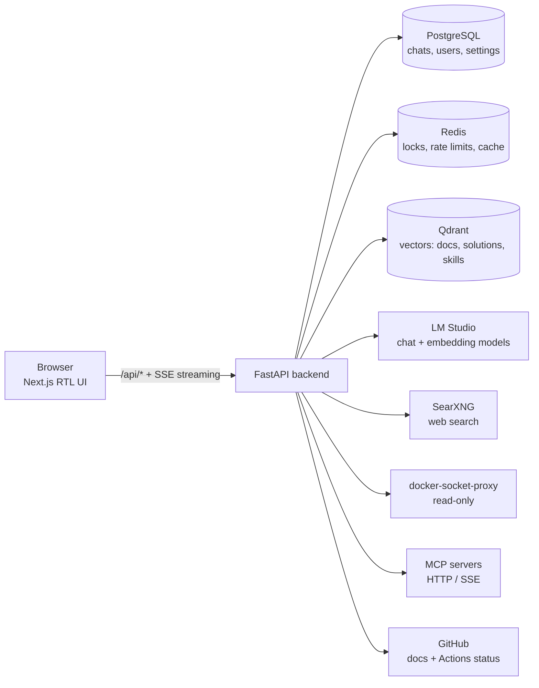

# DevOps AI Assistant — Project Overview

> A Persian-first (RTL) internal chat assistant for a DevOps team. It answers infrastructure questions and troubleshoots pasted errors from **your own approved runbooks first**, then confirmed solutions, then live tools and the web — and it always shows where an answer came from.

This document is the "presentation": what we built, why each technology was chosen, and how the pieces fit together.

---

## 1. The pitch in one minute

| Problem | What this project does |
|---|---|
| Team knowledge is scattered across wikis, chats and people's heads | One chat that searches **internal docs, confirmed fixes, GitHub docs and the web** — in that order |
| AI tools hallucinate and don't say where an answer came from | Every answer carries **citations, a confidence badge, and a source label** |
| Cloud AI is a data-privacy risk | Runs **fully local**: local LLM (LM Studio), local vector DB, self-hosted search. Secrets are **redacted** before storage or LLM calls |
| Assistants that can "run commands" are dangerous | **Read-only by design**: Docker access goes through a read-only proxy; MCP tools are **admin allow-listed**; risky commands in answers are **flagged** |
| Knowledge never improves | A **feedback loop**: users confirm/reject fixes, admins promote solved chats to docs, and a **weekly gap report** shows what to write next |

---

## 2. Architecture



**8 containers** in one `docker compose up`: `postgres`, `redis`, `qdrant`, `searxng`, `docker-proxy`, `backend`, `frontend`, and a sample `sample-mcp` server.

### How one question flows (the answer workflow)

A small explicit **state machine** (not a black-box agent), so every step is observable and timed:

```
gather_tools → plan_queries → check_answer_cache → retrieve_local ─┐
   (Docker/CI)   (error signature)   (reuse answers)   (internal docs + skills)
                                                                   ├→ generate ⇄ MCP tool loop
                          retrieve_cache → web_search ─────────────┘    (streamed to the UI)
                   (confirmed solutions)   (last resort, cached + single-flight)
```

- **Order is deterministic:** internal docs → confirmed solutions / cached web → live web.
- **Web search is last** and goes through a cache plus a lock, so the same problem is never searched twice.
- If nothing matches, the model answers from its **own knowledge and says so** (red "unverified" badge).
- A **`/server` or `/server@tool` command** skips retrieval and forces a specific MCP tool.

---

## 3. Technology stack

### Frontend
| Technology | Version | Role |
|---|---|---|
| **Next.js** (App Router) | 14.2 | Web framework, API proxy rewrite, SSE streaming |
| **React** | 18.3 | UI |
| **TypeScript** | 5.6 | Type safety (the Docker build fails on type errors) |
| **Tailwind CSS** | 3.4 | Styling, RTL/LTR, dark mode |
| **Radix UI** | dialog, tabs, slot | Accessible primitives |
| **TanStack Query** | 5 | Server state, polling, cache invalidation |
| **react-markdown** + remark-gfm + rehype-highlight | 10 | Answer rendering with code highlighting |
| **Recharts** | 2.13 | Admin analytics charts |
| **lucide-react**, class-variance-authority, clsx, tailwind-merge | — | Icons and component variants |
| **Node** (Alpine, multi-stage build) | 20 | Runtime image |

### Backend
| Technology | Version | Role |
|---|---|---|
| **Python** | 3.12 | Language |
| **FastAPI** + **Uvicorn** | 0.143 / 0.54 | Async REST API and Server-Sent Events |
| **Pydantic** + pydantic-settings | 2.14 | Validation and typed configuration (`.env`) |
| **SQLAlchemy** (async) + **asyncpg** | 2.1 / 0.32 | ORM and PostgreSQL driver |
| **Alembic** | 1.20 | Database migrations (5 so far) |
| **redis-py** | 8.1 | Rate limits, locks, cache |
| **qdrant-client** | 1.19 | Vector search |
| **httpx** | 0.28 | LLM, search and GitHub clients |
| **MCP Python SDK** | 1.30 | Model Context Protocol client |
| **PyJWT** + **bcrypt** | — | Authentication and password hashing |
| sentence-transformers *(optional)* | 3.x | In-container embeddings if no LLM server is used |

### Data & infrastructure
| Technology | Version | Role |
|---|---|---|
| **PostgreSQL** | 16 | 15 tables: users, conversations, messages, tool calls, solutions, feedback, documents, web cache, analytics events, settings, lessons, container grants/audit, MCP servers, skills |
| **Redis** | 7 | Rate limiting, single-flight locks, hot cache layer |
| **Qdrant** | 1.12.4 | Vector database (cosine, 1024-dim) — docs, solutions, lessons, skills |
| **SearXNG** | latest | Self-hosted web search (Tavily is a supported alternative) |
| **tecnativa/docker-socket-proxy** | 0.3.0 | Read-only Docker API for container inspection |
| **Docker Compose** | v2 | One-command deployment with health checks and volumes |

### AI layer
| Piece | Choice | Notes |
|---|---|---|
| **LLM server** | **LM Studio** (OpenAI-compatible API) | Ollama and any OpenAI-compatible server also supported |
| **Chat model** | `google/gemma-4-12b-qat` (Q4_0, 16k context) | ~40 tokens/s on an RTX 3080 Ti (12 GB) with reasoning off |
| **Embedding model** | `multilingual-e5-large-instruct` (1024-dim) | Strong Persian + English retrieval |
| **Function calling** | OpenAI-style `tools` | Powers MCP tool use |
| **Reasoning control** | `reasoning_effort` setting | `none` cut a test answer from 12.5 s to 2.5 s |

---

## 4. Feature tour

### For everyone (chat)
- **Streaming answers** with a collapsible "thinking" panel; leave the page and come back — the running answer **re-attaches** with its progress.
- **Citations** with the source type, plus a **download .md** button for the exact document used.
- **Trust signals** on every answer:
  - confidence badge — verified docs / live data / external / model-only,
  - collapsible **MCP tool evidence** (inputs and outputs),
  - **risky-command warning** (`rm -rf`, `docker system prune`, `kubectl delete`, `DELETE` without `WHERE`, `curl | bash`, …).
- **Clock icon** per message: search time, thinking time, writing time, tokens/second.
- **Token ring** next to the send button: context-window usage and totals for the chat.
- **Session memory**: a running summary of the problem, what was tried, and the next step.
- **Slash commands with autocomplete:** `/devops DNS مربوط به google.com را بگیر` or `/devops@dns_lookup …`.
- **Teaching mode**: users teach the assistant; nothing becomes active until an **admin verifies** it.
- **Container panel**: per-user permissions to view logs or start/stop/restart specific containers (fully audited).

### For admins
- **Documents**: folder **tree view**, upload / edit / delete, per-document and bulk re-index, live indexing progress and per-file error tooltips.
- **MCP servers**: register remote servers, discover tools, switch each tool on or off.
- **Skills**: Markdown playbooks that are **auto-selected** per question by embedding similarity.
- **Knowledge-gap report**: weekly view of what could not be answered (model-only, needed web, rejected fix), clustered by topic, exportable as Markdown.
- **Analytics dashboard**, **conversation review**, **solution promotion to docs**, **cache management**, **runtime settings** (web search, GitHub docs, answer cache), **system status**.

---

## 5. Key design decisions

1. **Local-first and private.** No cloud LLM is required; secrets are redacted before they are stored or sent to a model.
2. **Documentation before intelligence.** Retrieval order is fixed; the model must cite sources and mark its own knowledge as unverified.
3. **Read-only by default.** The assistant never runs anything. Fix commands are proposed for a human, with warnings.
4. **Prompt-injection aware.** Retrieved text and tool output are wrapped as *data*, never instructions. The MCP allow-list limits what a model can call.
5. **Explicit workflow over a free-form agent.** Predictable, debuggable, measurable (every step is timed and logged).
6. **Incremental knowledge.** Hash-based re-indexing, a heading-aware chunker that never splits a code block, and a skip check that verifies the vectors exist.
7. **Operational honesty.** Health checks for every dependency, stale-lock clearing on startup, and the UI tells users when the assistant isn't ready (for example, while indexing).

---

## 6. Security model

| Layer | Control |
|---|---|
| Authentication | Email + password, bcrypt hashes, JWT; admins create users (no public sign-up) |
| Authorization | Roles and permissions (a user has many roles, a role has many permissions; catalog in `app/permissions.py`); per-user container grants; per-tool MCP allow-list |
| Data protection | Secret redaction before DB storage and LLM calls |
| Docker access | Read-only socket proxy; actions are opt-in and audited |
| Abuse | Rate limiting (Redis) on chat and login |
| Prompt injection | Untrusted-data framing; tool results never treated as instructions |
| Output safety | Risky-command scanner on every answer |

---

## 7. By the numbers (current state)

- **~48,700 vectors** in Qdrant from **~4,000 Markdown files** (Kubernetes, Nginx, React, Next.js, Tailwind, Angular, shadcn plus the team's runbooks).
- **5 auto-matched skills** and a **5-tool sample MCP server** (DNS, TCP, HTTP, SSL expiry, time).
- **~10,000+ lines** of Python and TypeScript across 7 API modules, 25 service modules and 20+ UI components.
- **Command answer in ~2.4 s** end to end (tool call included); normal answers ~3–10 s on the local GPU.

---

## 8. Known limits and next steps

**Limits today**
- Single backend worker (turn re-attach and indexing progress are held in memory).
- No automated test suite yet — verification so far is manual and script-based.
- MCP supports **remote** servers (HTTP / SSE); local stdio servers need a wrapper.
- Persian quality depends on the chosen local model; the 12 GB GPU limits model size.

**Suggested roadmap**
1. "Promote a solved chat to a skill" button.
2. More MCP servers: Prometheus/Grafana, Kubernetes read-only, CI status, ticketing.
3. Proactive mode: alert webhooks that open a chat with a first diagnosis.
4. Roles and per-tool permissions; per-team knowledge spaces; Telegram/Slack bot.
5. Retrieval evaluation set and reranking to keep quality measurable as docs grow.
6. Automated tests and backups of the PostgreSQL volume.

---

## 9. Run it

```bash
cp .env.example .env        # set JWT_SECRET, passwords, ADMIN_EMAIL/PASSWORD, LLM_* and EMBEDDING_*
docker compose up -d --build
# open http://localhost:3000 and sign in with the admin account
```

LM Studio must be running with a chat model and an embedding model loaded; `LLM_BASE_URL` should point to `http://host.docker.internal:1234/v1` from inside the containers.
